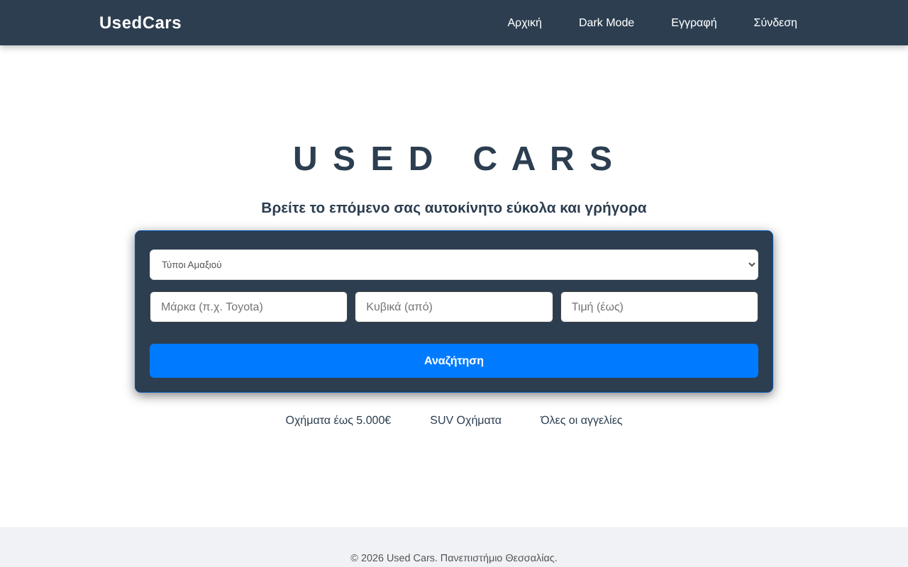
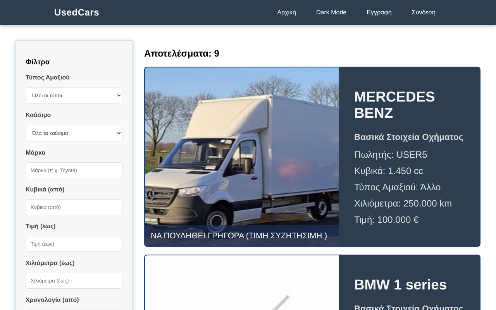
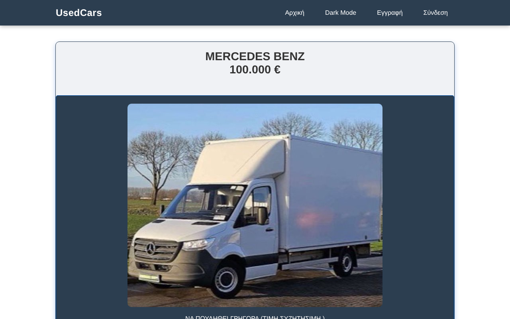
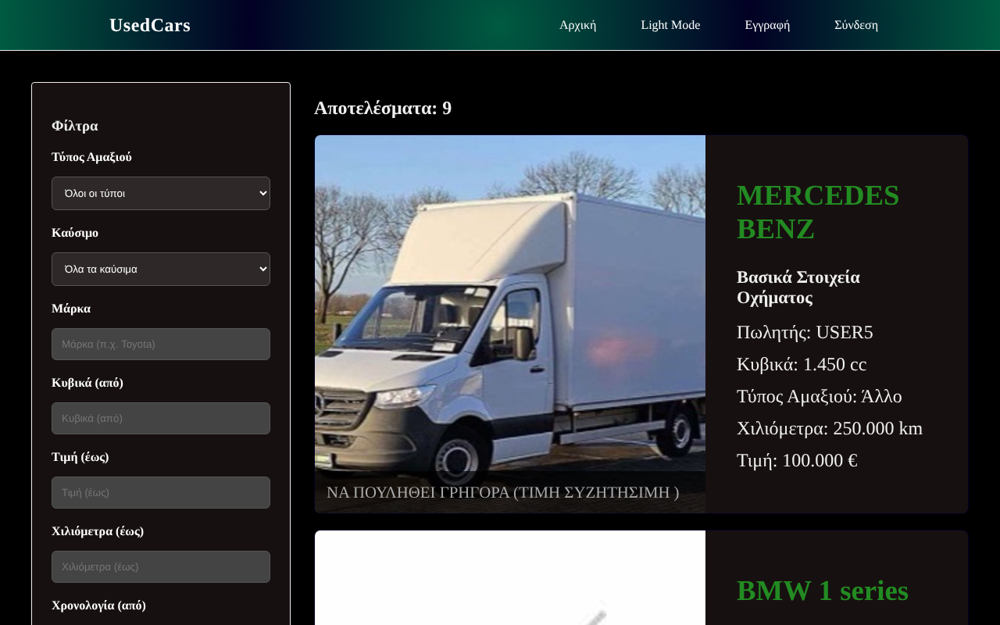

# Webcars — Used Car Listings (PHP & MySQL)

> Πλατφόρμα αγγελιών μεταχειρισμένων αυτοκινήτων — πανεπιστημιακή εργασία, Πανεπιστήμιο Θεσσαλίας.

Webcars is a server-rendered used-car marketplace built with plain PHP 8 and MySQL/MariaDB, no frameworks.
Users can register, activate their account, list their car, upload photos, and browse, filter and sort every listing.
The interface is in Greek.



## Features

- **Accounts**: registration with server- and client-side validation (the form keeps what you typed if something is wrong), a 5-digit activation code, and Google reCAPTCHA v2 on activation
- **Secure login**: `password_hash` / `password_verify` (bcrypt), session ID regeneration, protection against brute force (5 failed attempts → 15-minute block), redirect back to the page you came from
- **Car listings**: each user can create, edit and delete one listing (brand, model, body type, fuel, cc, mileage, registration date, turbo/hybrid/needs-repair flags, price)
- **Photo gallery**: up to 10 JPG photos per listing (250 KB each), checked by extension, MIME type and image header, stored under random UUID file names. Photos are re-saved on upload, so their EXIF metadata (e.g. the GPS location of the phone) is removed
- **Search**: filter by body type, fuel, brand (partial match), minimum cc, maximum price, maximum mileage and first registration year; sort by date, price, mileage or age; pagination
- **Listing page**: all details in readable form (e.g. "15.000 €", "Πετρέλαιο"), and the seller's phone and email for signed-in users
- **Light/dark theme**: one stylesheet, the choice is remembered in a cookie
- **Mobile friendly**: the layout adapts to small screens

### Security

- PDO prepared statements everywhere, output escaping (`htmlspecialchars`)
- CSRF tokens on every form that changes data, including login, logout and registration
- Session cookie with `HttpOnly` and `SameSite=Lax` (and `Secure` over HTTPS), strict session mode
- Same error message for "unknown user" and "wrong password", so usernames cannot be discovered
- reCAPTCHA checked server-side with a POST request and a timeout
- Database errors are logged, never shown to the visitor
- `.htaccess` files block script execution in `uploads/` and direct access to `includes/` and `database/` (Apache)
- Secrets kept out of the repository (`includes/config.php` is git-ignored)

## Tech stack

PHP 8.1+ (PDO, fileinfo, GD; EXIF optional) · MySQL 8 / MariaDB 10.4+ · HTML5 · CSS3 · vanilla JavaScript · Google reCAPTCHA v2

## Getting started

### Option A — Docker (one command)

```bash
docker compose up --build
```

Open <http://localhost:8080>. The database is created and filled with demo data automatically.
Demo accounts: `USER1` … `USER9`, password `demo_password1`.
Docker uses Google's public reCAPTCHA test keys, so the "I'm not a robot" box always passes.

### Option B — Your own PHP & MySQL (XAMPP, MAMP, …)

1. **Clone**
   ```bash
   git clone https://github.com/gianniszaf04/webcars.git
   cd webcars
   ```
2. **Create the database and a user**
   ```sql
   CREATE DATABASE webcars CHARACTER SET utf8mb4 COLLATE utf8mb4_unicode_ci;
   CREATE USER 'webcarsuser'@'localhost' IDENTIFIED BY 'choose-a-password';
   GRANT ALL PRIVILEGES ON webcars.* TO 'webcarsuser'@'localhost';
   ```
3. **Import the schema** (and optionally the demo data)
   ```bash
   mysql -u root -p webcars < database/schema.sql
   mysql -u root -p webcars < database/seed.sql   # optional: 9 demo users and cars
   ```
   Demo accounts: `USER1` … `USER9`, password `demo_password1`.
4. **Configure**
   ```bash
   cp includes/config.example.php includes/config.php
   ```
   Fill in your database password and your reCAPTCHA v2 keys from <https://www.google.com/recaptcha/admin>.
   For local testing, add `localhost` / `127.0.0.1` as domains.
5. **Run**
   ```bash
   php -S localhost:8000
   ```
   Open <http://localhost:8000>. With XAMPP or MAMP, put the folder in `htdocs/` instead.

`uploads/` must be writable by PHP.

### Upgrading an existing database

If you created your database with an older version of `schema.sql`, run this once (safe to run again):

```bash
mysql -u root -p webcars < database/upgrade.sql
```

It adds the `login_attempts` table and removes the unused `users.css_preference` column.

## Project structure

```
webcars/
├── index.php              # Landing page with quick search
├── search.php             # Filtered, sorted, paginated results
├── vehicles-info.php      # Single listing page (+ seller contact)
├── vehicles.php           # Create / edit / delete my listing (login required)
├── vehicles-images.php    # Upload / delete listing photos (login required)
├── register.php           # Sign-up
├── activate.php           # Account activation + reCAPTCHA
├── login.php / logout.php
├── switch_theme.php       # Light / dark theme toggle
├── includes/
│   ├── config.example.php # Copy to config.php (git-ignored)
│   ├── config_loader.php  # Reads config.php, or environment variables (Docker)
│   ├── db.connect.php     # PDO connection + error handler
│   ├── catalog.php        # Body/fuel types, sort options, price & date formatting
│   ├── userTracking.php   # Session, auth, escaping, CSRF and message helpers
│   ├── login_throttle.php # Brute-force protection for login
│   ├── recaptcha.php      # reCAPTCHA keys + server-side check
│   ├── theme_cookies.php
│   └── header.php / footer.php / search-sidebar.php
├── css/style.css          # Light theme + [data-theme="dark"] overrides + mobile
├── img/no-image.jpg       # Placeholder for listings without photos
├── uploads/               # User photos (git-ignored)
├── database/
│   ├── schema.sql
│   ├── seed.sql
│   └── upgrade.sql
├── docs/
│   ├── database-diagram.pdf
│   └── screenshots/
├── Dockerfile / docker-compose.yml
└── .github/workflows/ci.yml   # PHP syntax check + SQL import test on every push
```

## Database

Four tables: `users`, `cars` (one per user, `UNIQUE user_id`), `images` (many per car) and `login_attempts`.
Foreign keys use `ON DELETE CASCADE`. See [`docs/database-diagram.pdf`](docs/database-diagram.pdf).

## Screenshots

| Search | Listing | Dark mode |
|--------|---------|-----------|
|  |  |  |

## Notes

This was built as a university assignment (Web Programming, University of Thessaly, 2025–26).
The activation code is shown on screen instead of being emailed, because the assignment had no mail server.

## Author

**Ioannis Zafeiris**
